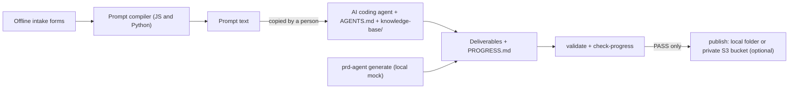

# PRD agent: from structured intake to consistent deliverables

> **Disclaimer.** This repository is a reference prototype for demonstration and learning. It is **not intended for
> production use**. You are responsible for how you deploy and use it and for the results, including any AWS
> charges. Before you use any part of it with real data, review it with your own security and legal teams; security
> and compliance are a shared responsibility between AWS and you
> ([AWS Shared Responsibility Model](https://aws.amazon.com/compliance/shared-responsibility-model/)). Deploy only
> to a non-production account, ideally one you can discard. See the [hardening checklist](SECURITY.md#hardening-before-production)
> before any production use.

Field engineers and product managers fill in a fixed intake template. The template produces a deterministic prompt.
An AI coding agent reads a numbered knowledge base and writes six IoT product deliverables. A checker then
confirms that all of them use the same thing model IDs. Suggested repository name: `prd-agent-requirements-to-deliverables`.

| Deliverable | Format | Consumer |
|---|---|---|
| Thing model | `thing-model.json` | Cloud platform, device developers |
| Product architecture | `architecture.mmd` (mermaid) | Reviewers |
| Quick-start integration guide | `quick-start.md` → `quick-start.pdf` | External developers |
| Requirements specification / PRD | `PRD.md` | Product, engineering |
| Panel interaction spec | `panel-spec.md` + `panel-preview.html` | Panel UI design |
| Device demo skeleton | `device-demo/` (C99) | Device developers |

## Architecture

The core runs locally and offline. An optional CDK stack adds a private S3 bucket for published bundles.
Components, trust boundaries, deployment topology and trade-offs: [docs/architecture.md](docs/architecture.md)
(the mermaid diagram there is the source of truth).



What is different from other LLM-to-PRD assets ([prior-art search](docs/prior-art.md)):

1. **Consistency keyed on the thing model ID.** `prd-agent validate` reads ID, identifier and access from fixed
   places in every deliverable and reports each difference as `file:line`.
2. **A numbered knowledge base with a reading order.** `AGENTS.md` makes the agent read `knowledge-base/00` to `10`
   in order: rules first, then templates, then the case.
3. **A staged progress protocol.** The agent reports at 10/25/45/70/90/100 percent and lists the files it has
   produced each time. `prd-agent check-progress` compares those lists with what is on disk.
4. **A warning before generating on insufficient input.** Missing or contradictory fields become a list of items to
   confirm, and the prompt switches to `CLARIFY_ONLY`. Nothing is guessed.

## Prerequisites and cost

- Python 3.12+ and [uv](https://docs.astral.sh/uv/). Node.js 24 is needed for the JS/Python parity test and for the
  CDK CLI. A C compiler is optional (device skeleton compile test). [gitleaks](https://github.com/gitleaks/gitleaks)
  for `make scan`.
- Optional AWS part: credentials for a **non-production** account in your shell (short-lived role credentials),
  and a region bootstrapped for CDK by the account owner (`cdk bootstrap`). Docker is not needed.

Cost: the local part has no cost. The optional stack is billed for S3 storage (including noncurrent object
versions and access logs), requests and data transfer; see [Amazon S3 pricing](https://aws.amazon.com/s3/pricing/).
No free tier is assumed. To be alerted early, create a budget with an email alert in AWS Budgets
([documentation](https://docs.aws.amazon.com/cost-management/latest/userguide/budgets-create.html)).

## Deploy

The local tools need no deployment (see [Usage and verification](#usage-and-verification)). For the optional
stack, all commands run from the repository root. This is the only place where the deployment commands are
written down; other documents refer here.

```bash
make init        # uv sync; creates infra/config/sandbox.json and customer.json from the *.example.json templates
# edit infra/config/sandbox.json if needed (it is not committed); parameters: docs/deployment-guide.md
make deploy      # preflight (asks you to confirm account and region), synth with cdk-nag, diff guard, deploy
```

- `make deploy` refuses a change set that deletes or replaces resources unless you set `ALLOW_DESTRUCTIVE=1`.
- To restrict who may write bundles, pass role or user ARNs as context (never stored in a file):
  `make deploy WRITERS=arn:aws:iam::111122223333:role/<PUBLISHER_ROLE_NAME>`.
- Another config file: `make deploy CONFIG=config/customer.json` (removal policy `retain`).

## Usage and verification

Local flow (no AWS):

```bash
make test                                        # unit tests
uv run prd-agent check-intake sample-data/smart-plug.pm.intake.json
uv run prd-agent compile-prompt sample-data/smart-plug.pm.intake.json      # paste into your AI tool
uv run prd-agent generate sample-data/smart-plug.missing-fields.intake.json --out out/missing   # exit 2, nothing written
uv run prd-agent generate sample-data/smart-plug.pm.intake.json --out out/smart-plug             # local mock of the agent
uv run prd-agent validate out/smart-plug
uv run prd-agent check-progress out/smart-plug
```

The intake forms `intake/pm.html` and `intake/frontline.html` open from disk without network access. A generated
example is in [`examples/smart-plug/`](examples/smart-plug/) and the compiled prompts are in
[`examples/prompts/`](examples/prompts/). Walkthrough: [docs/demo-script.md](docs/demo-script.md).

With an AI coding agent: open this repository as the workspace of an agent that reads `AGENTS.md` (for example Kiro,
see the fact check in [docs/architecture.md](docs/architecture.md#fact-check)), paste the compiled prompt, name an
output folder, then run `validate` and `check-progress` on it.

| Command | Purpose |
|---|---|
| `check-intake <intake.json>` | List pending items (exit 2 if any) |
| `compile-prompt <intake.json> [--out f]` | Deterministic prompt text |
| `generate <intake.json> --out <dir>` | Local reference generator; refuses on pending items (exit 2), exit 1 if its own validation fails, exit 3 on I/O or PDF errors (the target folder is then unchanged) |
| `validate <dir> [--format json] [--intake f]` | Consistency check keyed on ID. Without `--intake` the FR-7 files are required |
| `check-progress <dir> [--intake f]` | Progress protocol check |
| `render-pdf <quick-start.md>` | Markdown to PDF |
| `diff-model <old.json> <new.json> [--fail-on-breaking]` | Thing model change log |
| `build-forms` | Rebuild the two HTML forms from the schema and the system prompt |
| `publish <dir> --dest <dir or s3://bucket/prefix> --name <bundle> [--intake f]` | Publish a bundle that passes validation; an existing bundle name is refused |
| `fetch <src> --name <bundle> --out <dir>` | Download a bundle and verify checksums |

Exit codes: 0 ok, 1 check failed, 2 insufficient input, 3 usage or I/O error. Pass `--intake` when the intake
requested fewer deliverables than the FR-7 set (PRD, quick-start guide, device skeleton).

After `make deploy`, run `make verify`. It checks the bucket settings and runs an end-to-end publish/fetch, and it
checks that the controls deny what they should: plain HTTP, anonymous GET and PUT, re-publishing an existing bundle
name, and an S3 conditional write on an existing key. With `WRITERS` set to principals other than yours,
`uv run python scripts/ops.py verify --config infra/config/sandbox.json --expect-write-denied` checks that your
writes are denied. Publishing to the bucket: `uv run prd-agent publish <dir> --dest s3://<ARTIFACT_BUCKET_NAME>/bundles --name <BUNDLE_NAME>`
(the bucket name is the stack output `ArtifactBucketName`).

## Troubleshooting

| Symptom | Cause and fix |
|---|---|
| `config file infra/config/sandbox.json not found` | Run `make init` |
| `invalid deployment config: ...` during synth | The message lists every rule that failed (for example `destroy` is only allowed for `proto-*` stacks) |
| Preflight stops with "not confirmed" | Answer `yes` only if the shown account (last four digits) and region are your sandbox |
| `Refusing to deploy` after the diff | The change set deletes or replaces a resource. Check the listed resources; set `ALLOW_DESTRUCTIVE=1` only if intended |
| `refused: ... already exists; bundles are immutable` | Publish under a new bundle name |
| `cdk destroy` fails: bucket not empty | Late access-log deliveries; run `make destroy` again |
| Pending item "outside Latin-1" | Text that reaches the quick-start PDF must be Latin-1, or do not request `quick_start` |

## Security and limitations

Security controls, data handling and the hardening checklist: [SECURITY.md](SECURITY.md); details and cdk-nag
status: [SECURITY-NOTES.md](SECURITY-NOTES.md); threats: [THREAT_MODEL.md](THREAT_MODEL.md) (draft).

- No online AI call. Copying the prompt from the form into the AI tool is a deliberate manual step.
- The checker compares ID, identifier and access only, not ranges or prose. Visible text is checked only where it
  uses the fixed patterns listed in `knowledge-base/09`; other visible text is not checked.
- Deliverables are in English, because the built-in PDF font covers Latin-1 only. When the quick-start guide is
  requested, non-Latin-1 text in the fields that reach the PDF is a pending item.
- Panel output guarantees structure and ID mapping, not visual design.
- The agent follows the reading order because AGENTS.md instructs it to. The tool does not enforce it.
- The knowledge base contains one synthetic case. Other product classes need their own cases first.
- No effect data exists for this approach. The repository makes no claim about time saved.

More detail: [docs/architecture.md](docs/architecture.md#limitations).

## Cleanup

Local: delete the `out/` folder. AWS:

```bash
make destroy         # asks for the stack name, then separately before deleting bucket data; then cdk destroy
make verify-cleanup  # exits non-zero if anything with the project prefix is left
```

`make destroy` empties both buckets (all versions), destroys the stack, and deletes this project's template
objects from the CDK bootstrap bucket (matched by asset hash; nothing else there is touched). If a step fails it
prints a warning and continues. Details: [docs/cleanup.md](docs/cleanup.md).

Resources that are **not** deleted automatically (do not assume a finished command removed everything):
- The `CDKToolkit` bootstrap stack, its bucket and other objects in it (shared; owned by the account owner).
- Template objects of earlier deployments synthesized from other commits, unless their `cdk.out` folder is passed
  (`make destroy CDK_OUT=...` takes the folder of the current synth only).
- Both buckets and their data when the config uses `removal_policy: retain` (customer config).
- Access logs delivered after the buckets were emptied (re-run `make destroy`).
- Local files: `out/`, `/tmp/prd-agent-cdk.out`, `infra/config/*.json`.

## Repository layout

```
AGENTS.md, CLAUDE.md        agent reading order (FR-3) and contributor rules for AI assistants
intake/                     schema, offline forms, JS compiler
knowledge-base/00..10       numbered rules, templates, system prompt, case
src/prd_agent/              CLI: compiler, generator, checkers, PDF, change log, publish
examples/                   generated example and compiled prompts
sample-data/                synthetic intakes, including invalid ones
infra/                      optional CDK stack; config/*.example.json templates
scripts/                    ops.py (preflight, verify, cleanup, residue check), scan.sh, form smoke test
tests/                      pytest suite
docs/                       architecture, deployment parameters, cleanup, distribution, handover, prior art, review
.github/                    CI, manual deploy-verify workflow, Dependabot, templates, CODEOWNERS
```

## Local testing

```bash
make lint test synth scan    # the same targets CI runs; they do not modify files
```

`make synth` runs cdk-nag AwsSolutions and needs no AWS credentials. `make scan` runs gitleaks on the full history
and checks that a planted canary credential is detected. Results of the last full run: [VERIFICATION.md](VERIFICATION.md).

## Contributing

See [CONTRIBUTING](CONTRIBUTING.md) for more information.

## Security

See [SECURITY](SECURITY.md) for more information.

## License

This library is licensed under the MIT-0 License. See the [LICENSE](LICENSE) file.
