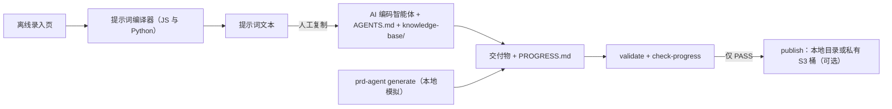

# PRD 智能体：从结构化需求录入到一致的交付物

> **免责声明。** 本仓库是用于演示和学习的原型参考实现，**不用于生产环境**。如何部署、如何使用以及由此产生的后果
> （包括 AWS 费用）由使用方自行负责。在把任何部分用于真实数据之前，请与您自己的安全和法务团队一起评估；安全与合规
> 由 AWS 和您共同承担（[AWS 责任共担模型](https://aws.amazon.com/compliance/shared-responsibility-model/)）。只部署到
> 非生产账号，最好是可以随时丢弃的账号。用于生产前请先看[加固清单](SECURITY.md#hardening-before-production)。

一线人员和产品经理按固定模板填写需求，模板生成一段确定性提示词；AI 编码智能体按编号知识库的顺序阅读后，产出六份
IoT 产品交付物；最后由校验脚本确认这些交付物里的物模型 ID 一致。建议仓库名：`prd-agent-requirements-to-deliverables`。

| 交付物 | 格式 | 消费方 |
|---|---|---|
| 物模型 | `thing-model.json` | 云平台、设备端研发 |
| 产品架构图 | `architecture.mmd`（mermaid） | 评审 |
| 快速接入文档 | `quick-start.md` → `quick-start.pdf` | 外部开发者 |
| 需求规格说明书 / PRD | `PRD.md` | 产品、研发 |
| 面板交互说明与样式 | `panel-spec.md` + `panel-preview.html` | 面板 UI 设计 |
| 设备端 Demo 骨架 | `device-demo/`（C99） | 设备端研发 |

## 架构

核心流程在本地离线运行。可选的 CDK 栈只增加一个私有 S3 桶，用来存放发布的交付物包。组件、信任边界、部署拓扑和取舍见
[docs/architecture.md](docs/architecture.md)（其中的 mermaid 图是事实来源）。



与其他「用 LLM 生成 PRD」资产的差异（检索见 [docs/prior-art.md](docs/prior-art.md)）：

1. **以物模型 ID 为主键做跨制品一致性校验**：`prd-agent validate` 从每份交付物的固定位置读出 ID、标识符和读写属性，有差异时逐条输出 `文件:行号`。
2. **编号知识库加读取顺序**：`AGENTS.md` 规定按 `knowledge-base/00` 到 `10` 的顺序阅读，规则在前，模板居中，案例最后。
3. **分段进度协议**：智能体在 10/25/45/70/90/100% 六个节点报告进度并列出已产出文件；`prd-agent check-progress` 拿清单和磁盘上的文件对照。
4. **输入不足先预警**：缺字段或字段矛盾时先列出待确认项，提示词切换为 `CLARIFY_ONLY`，不猜测补全。

## 前置条件和成本

- Python 3.12+ 和 [uv](https://docs.astral.sh/uv/)。JS/Python 一致性测试和 CDK CLI 需要 Node.js 24。C 编译器可选（Demo 骨架编译测试）。`make scan` 需要 [gitleaks](https://github.com/gitleaks/gitleaks)。
- 可选的 AWS 部分：shell 中有**非生产**账号的凭证（建议短期角色凭证），目标区域已由账号所有者完成 `cdk bootstrap`。不需要 Docker。

成本：本地部分没有费用。可选栈按 S3 存储（含非当前对象版本和访问日志）、请求和数据传输计费，价格见
[Amazon S3 定价页](https://aws.amazon.com/s3/pricing/)。不假设任何免费额度。可在 AWS Budgets 中创建带邮件告警的预算以便及早发现费用
（[文档](https://docs.aws.amazon.com/cost-management/latest/userguide/budgets-create.html)）。

## 部署

本地工具不需要部署（见[使用和验证](#使用和验证)）。可选栈的所有命令都在仓库根目录执行。部署命令只写在这里，其他文档都引用本节。

```bash
make init        # uv sync；从 *.example.json 模板生成 infra/config/sandbox.json 和 customer.json
# 按需修改 infra/config/sandbox.json（该文件不入库）；参数说明见 docs/deployment-guide.md
make deploy      # 预检（要求确认账号和区域）、带 cdk-nag 的 synth、diff 保护、部署
```

- 变更集中有删除或替换资源时，`make deploy` 默认拒绝，需显式设置 `ALLOW_DESTRUCTIVE=1`。
- 限制谁能写入交付物包：把角色或用户 ARN 作为 context 传入（不写进任何文件）：
  `make deploy WRITERS=arn:aws:iam::111122223333:role/<PUBLISHER_ROLE_NAME>`。
- 使用其他配置文件：`make deploy CONFIG=config/customer.json`（删除策略 `retain`）。

## 使用和验证

本地流程（不需要 AWS）：

```bash
make test                                        # 单元测试
uv run prd-agent check-intake sample-data/smart-plug.pm.intake.json
uv run prd-agent compile-prompt sample-data/smart-plug.pm.intake.json      # 人工复制到 AI 工具
uv run prd-agent generate sample-data/smart-plug.missing-fields.intake.json --out out/missing   # 退出码 2，不写任何文件
uv run prd-agent generate sample-data/smart-plug.pm.intake.json --out out/smart-plug             # 智能体的本地模拟
uv run prd-agent validate out/smart-plug
uv run prd-agent check-progress out/smart-plug
```

录入页 `intake/pm.html` 和 `intake/frontline.html` 可直接从磁盘打开，不联网。生成示例见 [`examples/smart-plug/`](examples/smart-plug/)，
编译好的提示词见 [`examples/prompts/`](examples/prompts/)，演示步骤见 [docs/demo-script.md](docs/demo-script.md)。

配合 AI 编码智能体：用支持 `AGENTS.md` 的智能体（例如 Kiro，依据见 [docs/architecture.md](docs/architecture.md#fact-check) 的事实核对）
打开本仓库，粘贴提示词并指定输出目录，完成后对该目录运行 `validate` 和 `check-progress`。

| 命令 | 用途 |
|---|---|
| `check-intake <intake.json>` | 列出待确认项（有待确认项时退出码 2） |
| `compile-prompt <intake.json> [--out f]` | 生成确定性提示词文本 |
| `generate <intake.json> --out <dir>` | 本地参考生成器；有待确认项时拒绝生成（退出码 2），自身校验失败时退出码 1，I/O 或 PDF 错误时退出码 3（此时目标目录保持不变） |
| `validate <dir> [--format json] [--intake f]` | 以 ID 为主键的一致性校验。不带 `--intake` 时 FR-7 的文件必须存在 |
| `check-progress <dir> [--intake f]` | 进度协议校验 |
| `render-pdf <quick-start.md>` | Markdown 转 PDF |
| `diff-model <old.json> <new.json> [--fail-on-breaking]` | 物模型变更记录 |
| `build-forms` | 根据 schema 和系统提示词重新生成两个 HTML 录入页 |
| `publish <dir> --dest <目录或 s3://bucket/prefix> --name <bundle> [--intake f]` | 发布通过校验的交付物包；包名已存在时拒绝发布 |
| `fetch <src> --name <bundle> --out <dir>` | 下载交付物包并校验校验和 |

退出码：0 正常，1 校验失败，2 输入不足，3 用法或 I/O 错误。录入中请求的交付物少于 FR-7 的集合（PRD、快速接入文档、设备端骨架）时，加 `--intake`。

`make deploy` 之后运行 `make verify`：检查桶的配置并做一次发布/拉取的端到端验证，同时确认各项控制确实生效——明文 HTTP、
匿名 GET 和 PUT、用已存在的包名重发、对已有 key 的 S3 条件写入都会被拒绝。若 `WRITERS` 设为您以外的主体，运行
`uv run python scripts/ops.py verify --config infra/config/sandbox.json --expect-write-denied` 可确认您的写入被拒绝。
发布到桶：`uv run prd-agent publish <dir> --dest s3://<ARTIFACT_BUCKET_NAME>/bundles --name <BUNDLE_NAME>`（桶名为栈输出 `ArtifactBucketName`）。

## 故障排查

| 现象 | 原因与处理 |
|---|---|
| `config file infra/config/sandbox.json not found` | 运行 `make init` |
| synth 时报 `invalid deployment config: ...` | 信息中列出所有未通过的规则（例如 `destroy` 只允许用于 `proto-*` 栈） |
| 预检提示 "not confirmed" 后停止 | 只有显示的账号（末 4 位）和区域确实是沙箱时才回答 `yes` |
| diff 之后出现 `Refusing to deploy` | 变更集会删除或替换资源。核对列出的资源，确属预期才设置 `ALLOW_DESTRUCTIVE=1` |
| `refused: ... already exists; bundles are immutable` | 换一个新包名发布 |
| `cdk destroy` 失败：桶不为空 | 访问日志延迟送达；再运行一次 `make destroy` |
| 待确认项提示 "outside Latin-1" | 进入快速接入 PDF 的文本必须是 Latin-1，或者不请求 `quick_start` |

## 安全与局限

安全控制、数据处理和加固清单见 [SECURITY.md](SECURITY.md)；细节和 cdk-nag 状态见 [SECURITY-NOTES.md](SECURITY-NOTES.md)；
威胁见 [THREAT_MODEL.md](THREAT_MODEL.md)（草稿）。

- 不在线调用 AI。从录入台到 AI 工具之间是人工复制，这是刻意的取舍。
- 校验只比对 ID、标识符和读写属性，不比对取值范围和正文内容。可见文本只在使用 `knowledge-base/09` 中列出的固定格式时才校验，其他可见文本不校验。
- 交付物使用英文，因为内置 PDF 字体只覆盖 Latin-1。请求快速接入文档时，进入 PDF 的字段如含 Latin-1 以外的字符，会列为待确认项。
- 面板只保证结构和 ID 映射正确，不保证视觉效果。
- 读取顺序靠 AGENTS.md 中的指令约束，工具本身不强制执行。
- 知识库只有一个合成案例。用于其他产品类别前需先补充对应案例。
- 本项目没有效果数据，仓库中不声明任何效率或质量提升。

更多细节见 [docs/architecture.md](docs/architecture.md#limitations)。

## 清理

本地：删除 `out/` 目录。AWS：

```bash
make destroy         # 先要求输入栈名确认，删除桶内数据前再单独确认一次；然后执行 cdk destroy
make verify-cleanup  # 项目前缀的资源有任何残留时以非零退出
```

`make destroy` 会清空两个桶（含所有版本）、销毁栈，并从 CDK bootstrap 桶中删除属于本项目的模板对象（按资产哈希识别，桶内其他对象不动）。
某一步失败时给出警告并继续执行后续步骤。细节见 [docs/cleanup.md](docs/cleanup.md)。

**不会**被自动删除的资源（不要以为命令跑完就删干净了）：
- `CDKToolkit` bootstrap 栈、它的桶以及桶里的其他对象（共享资源，归账号所有者管理）。
- 用其他提交 synth 出的早期部署的模板对象，除非传入当时的 `cdk.out` 目录（`make destroy CDK_OUT=...` 只取当前 synth 的目录）。
- 配置为 `removal_policy: retain`（customer 配置）时的两个桶及其数据。
- 清空之后才送达的访问日志（再运行一次 `make destroy`）。
- 本地文件：`out/`、`/tmp/prd-agent-cdk.out`、`infra/config/*.json`。

## 目录结构

```
AGENTS.md, CLAUDE.md        智能体读取顺序（FR-3）以及 AI 助手的贡献规则
intake/                     schema、离线录入页、JS 编译器
knowledge-base/00..10       编号规则、模板、系统提示词、案例
src/prd_agent/              CLI：编译器、生成器、校验器、PDF、变更记录、发布
examples/                   生成示例和编译好的提示词
sample-data/                合成录入数据，包括故意不合法的样本
infra/                      可选 CDK 栈；config/*.example.json 模板
scripts/                    ops.py（预检、验证、清理、残留核对）、scan.sh、录入页冒烟测试
tests/                      pytest 测试
docs/                       架构、部署参数、清理、分发、交接、prior art、规范 review
.github/                    CI、手动部署验证 workflow、Dependabot、模板、CODEOWNERS
```

## 本地测试

```bash
make lint test synth scan    # 与 CI 相同的目标，不会修改任何文件
```

`make synth` 运行 cdk-nag AwsSolutions，不需要 AWS 凭证。`make scan` 用 gitleaks 扫描完整历史，并确认能检出植入的假凭证。
最近一次完整运行的结果见 [VERIFICATION.md](VERIFICATION.md)。

## Contributing

See [CONTRIBUTING](CONTRIBUTING.md) for more information.

## Security

See [SECURITY](SECURITY.md) for more information.

## License

This library is licensed under the MIT-0 License. See the [LICENSE](LICENSE) file.
