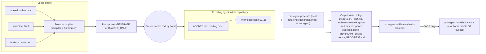

# Architecture

## Overview

Components:

| Component | Path | Role |
|---|---|---|
| Intake schema | `intake/schema.json` | Single definition of sections, fields, required flags, options, examples and cross-field rules |
| Intake forms | `intake/frontline.html`, `intake/pm.html` | Static single-file pages built by `prd-agent build-forms`. No network (CSP `default-src 'none'`) and no AI callback |
| Prompt compiler | `intake/compiler.js`, `src/prd_agent/prompt.py`, `src/prd_agent/intake.py` | Same logic in two languages, compared byte for byte by a test |
| Knowledge base | `AGENTS.md`, `knowledge-base/` | Numbered rules, templates and a case; the number is the reading order |
| Reference generator | `src/prd_agent/generate.py` | Deterministic local mock of the agent. Fills the knowledge-base templates; refuses on pending items |
| Consistency checker | `src/prd_agent/consistency.py` | Compares ID, identifier and access across deliverables with thing-model.json |
| Progress checker | `src/prd_agent/progress.py` | Verifies PROGRESS.md against the files on disk |
| PDF renderer | `src/prd_agent/pdf.py` | Markdown subset to PDF (pure Python), embeds the source hash |
| Change tracking | `src/prd_agent/changes.py` | Thing model diff by ID with a breaking/compatible flag |
| Distribution | `src/prd_agent/publish.py`, `docs/distribution.md` | Bundle plus manifest to a local folder or `s3://` |
| Optional infra | `infra/` | One CDK stack: private versioned S3 bucket plus access log bucket |

## Design choices

- **Manual copy between form and AI tool.** The form calls no AI service. This keeps the form usable offline, keeps
  intake data out of any third-party call made by the form, and lets any AI tool be used. The cost is one manual
  step. (Project non-goal; DECISIONS.md D-01.)
- **Two compilers, one test.** The browser needs JavaScript and the CLI and tests need Python. A parity test runs
  both on the same fixtures, edge cases included. (D-03.)
- **The thing model is the reference.** The consistency check compares against thing-model.json rather than
  taking a majority vote, as FR-6 asks. When every other file disagrees with the same thing-model line, the report
  adds a hint that the thing model was probably the edited file. (D-06.)
- **Markers instead of free-text parsing.** Each deliverable carries ID, identifier and access in one fixed,
  documented place (dp-table markers, data attributes, mermaid label format, C macros). This is stricter for the
  agent, but the checker does not have to guess. (D-07.)
- **The generator is a mock of the agent and fills the knowledge-base templates.** The example output and the
  rules come from the same files, so they cannot drift apart unnoticed: a test regenerates `examples/` and
  compares it byte for byte.
- **English deliverables, bilingual forms.** The built-in PDF fonts only cover Latin-1. Deliverables are English;
  form labels are Chinese and English. (D-09.)
- **Optional AWS part.** The core runs locally. The only cloud part is a private S3 bucket for published bundles,
  with no compute and no public endpoint. (D-11.)

## Limitations

- The reading order is an instruction in AGENTS.md. The Kiro documentation does not state a load order between
  steering files, so the order is not enforced by the tool (see Fact check). The progress protocol and the
  validator detect the result of a wrong order; they do not prevent it.
- The validator checks only ID, identifier and access. It does not check ranges, units or prose.
- The PDF is not parsed. Its freshness is checked through the embedded SHA-256 of quick-start.md.
- The PDF renderer supports a Markdown subset and Latin-1 text only. A Unicode font would need to be bundled to
  render Chinese text (not included, so that no font licence has to be reviewed).
- The mermaid diagram is checked by regular expressions and has not been rendered. No mermaid renderer ran in
  verification.
- The device demo is a structure skeleton. It compiles as C99 but is not firmware.
- `string` is the only type for structured values (for example timer lists). Their encoding is left as an open item.
- The JS and Python compilers are only guaranteed to match for decimal numbers without exponent notation.
  The form produces such numbers.

## Fact check

All checked on 2026-10-20 against the linked official pages.

| # | Statement used in this repository | Source |
|---|---|---|
| 1 | Kiro supports steering directives through AGENTS.md. An AGENTS.md in the workspace root, or in the global steering location `~/.kiro/steering/`, is picked up automatically | https://kiro.dev/docs/steering/ |
| 2 | AGENTS.md files do not support inclusion modes and are always included | https://kiro.dev/docs/steering/ |
| 3 | Kiro also discovers AGENTS.md files in workspace subdirectories and loads them as steering context, so this repository keeps a single AGENTS.md at the root | https://kiro.dev/docs/steering/ |
| 4 | Workspace steering files are in `.kiro/steering/` and global ones in `~/.kiro/steering/`. On conflict, workspace steering takes priority | https://kiro.dev/docs/steering/ |
| 5 | Steering inclusion modes are `always`, `fileMatch`, `manual` and `auto`, set in YAML front matter | https://kiro.dev/docs/steering/ |
| 6 | The Kiro steering documentation states no load order among multiple steering or AGENTS.md files. This repository therefore claims no order enforced by the tool; the order is an instruction in AGENTS.md | https://kiro.dev/docs/steering/ (no such statement found) |
| 7 | S3 recommends allowing only HTTPS through the `aws:SecureTransport` condition in bucket policies, using Block Public Access, enabling server access logging and versioning, and disabling ACLs (bucket owner enforced) | https://docs.aws.amazon.com/AmazonS3/latest/userguide/security-best-practices.html |
| 8 | SSE-S3 is the base encryption for every bucket. A server access log destination bucket must use SSE-S3 (with SSE-KMS, log objects may be undeliverable or unreadable) | https://docs.aws.amazon.com/AmazonS3/latest/userguide/default-bucket-encryption.html |
| 9 | cdk-nag AwsSolutions S1 flags a bucket with server access logs disabled; S2 flags public access not blocked; S10 flags a bucket that does not require SSL | https://github.com/cdklabs/cdk-nag/blob/main/RULES.md |

The assertion that the requirements input asked to verify was the Kiro reading rules and paths for `AGENTS.md` and steering files.
Rows 1 to 6 handle it.

Statements that could not be verified were removed and are not in the repository:
- A load order or precedence between AGENTS.md and `.kiro/steering/*.md`, or between the root AGENTS.md and
  AGENTS.md files in subdirectories (the documentation does not state one).
- Whether file references inside steering files behave the same on every Kiro surface (not confirmed; not used).
