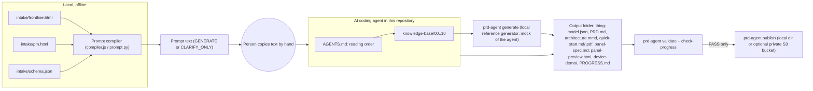

# Architecture

Applies to v0.1.0. The infrastructure parts were reviewed against commit `03ba5dc`
(`feat(infra): config templates, validation, guarded ops and resource policy`); see CHANGELOG.md for later changes.
The mermaid diagrams in this file are the source of truth; there are no rendered images.

## Overview

Components:

| Component | Path | Role |
|---|---|---|
| Intake schema | `intake/schema.json` | Single definition of sections, fields, required flags, options, examples and cross-field rules |
| Intake forms | `intake/frontline.html`, `intake/pm.html` | Static single-file pages built by `prd-agent build-forms`. No network (CSP `default-src 'none'`) and no AI callback |
| Prompt compiler | `intake/compiler.js`, `src/prd_agent/prompt.py`, `src/prd_agent/intake.py` | Same logic in two languages, compared byte for byte by a test |
| Knowledge base | `AGENTS.md`, `knowledge-base/` | Numbered rules, templates and a case; the number is the reading order |
| System prompt | `knowledge-base/00-project-rules/system-prompt.md` | Versioned agent instructions (FR-9). `prompt.py` reads it at run time; `build-forms` embeds it in the forms for `compiler.js` |
| Reference generator | `src/prd_agent/generate.py` | Deterministic local mock of the agent. Fills the knowledge-base templates; refuses on pending items |
| Consistency checker | `src/prd_agent/consistency.py` | Compares ID, identifier and access across deliverables with thing-model.json |
| Progress checker | `src/prd_agent/progress.py` | Verifies PROGRESS.md against the files on disk |
| PDF renderer | `src/prd_agent/pdf.py` | Markdown subset to PDF (pure Python), embeds the source hash |
| Change tracking | `src/prd_agent/changes.py` | Thing model diff by ID with a breaking/compatible flag |
| Distribution | `src/prd_agent/publish.py`, `docs/distribution.md` | Bundle plus manifest to a local folder or `s3://` |
| Optional infra | `infra/` | One CDK stack: private versioned S3 bucket plus access log bucket |
| Operations | `Makefile`, `scripts/ops.py`, `scripts/scan.sh` | Preflight, guarded deploy, end-to-end verification, confirmed cleanup, residue check, secret scan |

## Trust boundaries

| # | Boundary | What crosses it | Control |
|---|---|---|---|
| 1 | Person → intake form / JSON | Untrusted free text | Schema validation, reserved markers and Latin-1 rules (pending items), length limits |
| 2 | Prompt text → AI tool (manual copy) | Untrusted text inside INTAKE-BEGIN/END | Marker neutralisation, header echoes only known values, project rules R5/R7 (THREAT_MODEL.md) |
| 3 | AI agent → repository workspace | Files written by the agent | Rule R7 (output folder only), `validate` and `check-progress`, code review |
| 4 | Workstation → AWS account (optional) | Bundles, CDK deployment | Caller's short-lived credentials, TLS 1.2+, bucket policy (account boundary, optional writer list), preflight confirmation |
| 5 | Bucket → consumers | Published bundles | Checksums in MANIFEST.json verified by `fetch`; immutable bundle names |

## Deployment topology

```mermaid
flowchart TB
  subgraph WS["Workstation or CI runner"]
    MK["make deploy / verify / destroy"]
    CLI["prd-agent publish / fetch"]
  end
  subgraph ACC["Non-production AWS account, one region (default us-east-1)"]
    BOOT["CDKToolkit bootstrap stack (shared, not modified)"]
    subgraph STK["Stack proto-prd-artifacts"]
      AB["S3 artifact bucket: versioned, SSE-S3, BPA, TLS 1.2+, deny outside account"]
      LB["S3 access log bucket: SSE-S3, BPA, TLS 1.2+"]
    end
  end
  MK -->|"CloudFormation via CDK; template asset in the bootstrap bucket"| BOOT
  MK --> STK
  CLI -->|"HTTPS, conditional PutObject, GetObject"| AB
  AB -->|"server access logs (logging.s3.amazonaws.com, SourceArn + SourceAccount)"| LB
```

There is no compute, no network endpoint of our own and no cross-account access. One stack per environment;
the sandbox stack name starts with `proto-prd-`.

## Design choices

- **Manual copy between form and AI tool.** The form calls no AI service. This keeps the form usable offline, keeps
  intake data out of any third-party call made by the form, and lets any AI tool be used. The cost is one manual
  step. (Project non-goal; DECISIONS.md D-01.)
- **Two compilers, one test.** The browser needs JavaScript and the CLI and tests need Python. A parity test runs
  both on the same fixtures, edge cases included. (D-03.)
- **The thing model is the reference.** The consistency check compares against thing-model.json rather than
  taking a majority vote, as FR-6 asks. When every other file disagrees with the same thing-model line, the report
  adds a hint that the thing model was probably the edited file. (D-06.)
- **Markers instead of free-text parsing.** Each deliverable carries ID, identifier and access in one fixed,
  documented place (dp-table markers, data attributes, mermaid label format, C macros). This is stricter for the
  agent, but the checker does not have to guess. (D-07.)
- **The generator is a mock of the agent and fills the knowledge-base templates.** The example output and the
  rules come from the same files, so they cannot drift apart unnoticed: a test regenerates `examples/` and
  compares it byte for byte.
- **English deliverables, bilingual forms.** The built-in PDF fonts only cover Latin-1. Deliverables are English;
  form labels are Chinese and English. (D-09.)
- **Optional AWS part.** The core runs locally. The only cloud part is a private S3 bucket for published bundles,
  with no compute and no public endpoint. (D-11.)

## Limitations

- The reading order is an instruction in AGENTS.md. The Kiro documentation does not state a load order between
  steering files, so the order is not enforced by the tool (see Fact check). The progress protocol and the
  validator detect the result of a wrong order; they do not prevent it.
- The validator checks only ID, identifier and access. It does not check ranges, units or prose.
- The PDF is not parsed. Its freshness is checked through the embedded SHA-256 of quick-start.md.
- The PDF renderer supports a Markdown subset and Latin-1 text only. A Unicode font would need to be bundled to
  render Chinese text (not included, so that no font licence has to be reviewed).
- The mermaid diagram is checked by regular expressions and has not been rendered. No mermaid renderer ran in
  verification.
- The device demo is a structure skeleton. It compiles as C99 but is not firmware.
- `string` is the only type for structured values (for example timer lists). Their encoding is left as an open item.
- Numbers are printed as plain decimals without exponent in both compilers (for example `0.00001`). Integers
  beyond ±(2^53 − 1) are rejected as invalid, because JavaScript cannot represent them exactly. Within that range
  the JS and Python output is identical; the parity test covers small decimals, `-0` and the range limits.

## Fact check

Each row gives the date it was last checked against the linked official page.

| # | Statement used in this repository | Source | Checked |
|---|---|---|---|
| 1 | Kiro supports steering directives through AGENTS.md. An AGENTS.md in the workspace root, or in the global steering location `~/.kiro/steering/`, is picked up automatically | https://kiro.dev/docs/steering/ | 2026-10-20 |
| 2 | AGENTS.md files do not support inclusion modes and are always included | https://kiro.dev/docs/steering/ | 2026-10-20 |
| 3 | Kiro also discovers AGENTS.md files in workspace subdirectories and loads them as steering context, so this repository keeps a single AGENTS.md at the root | https://kiro.dev/docs/steering/ | 2026-10-20 |
| 4 | Workspace steering files are in `.kiro/steering/` and global ones in `~/.kiro/steering/`. On conflict, workspace steering takes priority | https://kiro.dev/docs/steering/ | 2026-10-20 |
| 5 | Steering inclusion modes are `always`, `fileMatch`, `manual` and `auto`, set in YAML front matter | https://kiro.dev/docs/steering/ | 2026-10-20 |
| 6 | The Kiro steering documentation states no load order among multiple steering or AGENTS.md files. This repository therefore claims no order enforced by the tool; the order is an instruction in AGENTS.md | https://kiro.dev/docs/steering/ (no such statement found) | 2026-10-20 |
| 7 | S3 recommends allowing only HTTPS through the `aws:SecureTransport` condition in bucket policies, using Block Public Access, enabling server access logging and versioning, and disabling ACLs (bucket owner enforced) | https://docs.aws.amazon.com/AmazonS3/latest/userguide/security-best-practices.html | 2026-10-20 |
| 8 | SSE-S3 is the base encryption for every bucket. A server access log destination bucket must use SSE-S3 (with SSE-KMS default encryption, S3 might deliver log objects encrypted with a key you cannot access) | https://docs.aws.amazon.com/AmazonS3/latest/userguide/default-bucket-encryption.html | 2026-10-20 |
| 9 | cdk-nag AwsSolutions S1 flags a bucket with server access logs disabled; S2 flags public access not blocked; S10 flags a bucket that does not require SSL | https://github.com/cdklabs/cdk-nag/blob/main/RULES.md | 2026-10-20 |
| 10 | A `PutObject` with `If-None-Match: *` fails with 412 Precondition Failed if an object (the current version, in a versioned bucket) with the key exists; it needs only `s3:PutObject` | https://docs.aws.amazon.com/AmazonS3/latest/userguide/conditional-writes.html | 2026-10-20 |
| 11 | `aws:PrincipalAccount` is in the request context of every request; for anonymous requests its value is `anonymous`. `aws:PrincipalArn` holds the role ARN (not the session ARN) for assumed roles and is absent for anonymous requests | https://docs.aws.amazon.com/IAM/latest/UserGuide/reference_policies_condition-keys.html | 2026-10-20 |
| 12 | Server access log delivery needs `s3:PutObject` for `logging.s3.amazonaws.com` on the destination bucket, limited with `aws:SourceArn` and `aws:SourceAccount`; Deny statements must not prevent delivery | https://docs.aws.amazon.com/AmazonS3/latest/userguide/enable-server-access-logging.html | 2026-10-20 |

The assertion that the requirements input asked to verify was the Kiro reading rules and paths for `AGENTS.md` and steering files.
Rows 1 to 6 handle it.

Statements that could not be verified were removed and are not in the repository:
- A load order or precedence between AGENTS.md and `.kiro/steering/*.md`, or between the root AGENTS.md and
  AGENTS.md files in subdirectories (the documentation does not state one).
- Whether file references inside steering files behave the same on every Kiro surface (not confirmed; not used).
